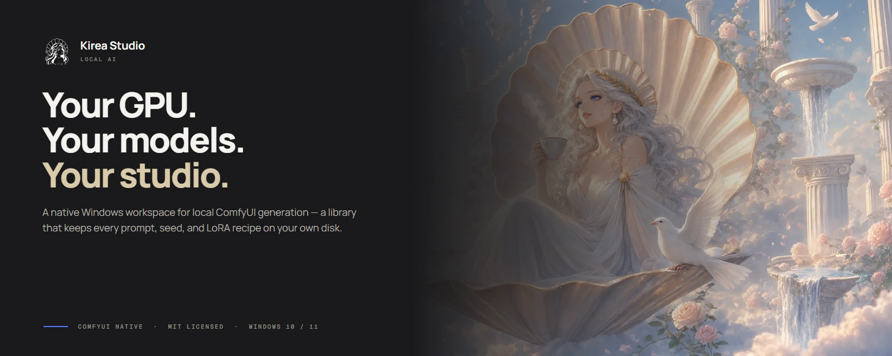
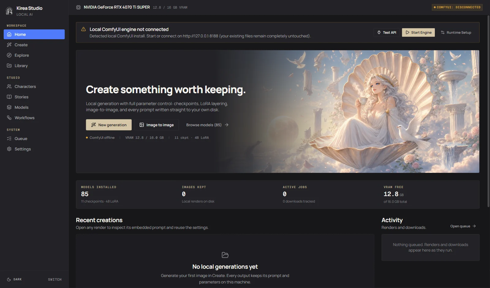
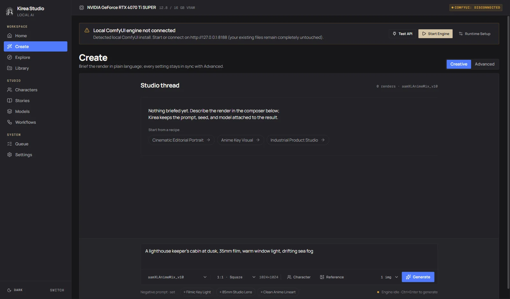
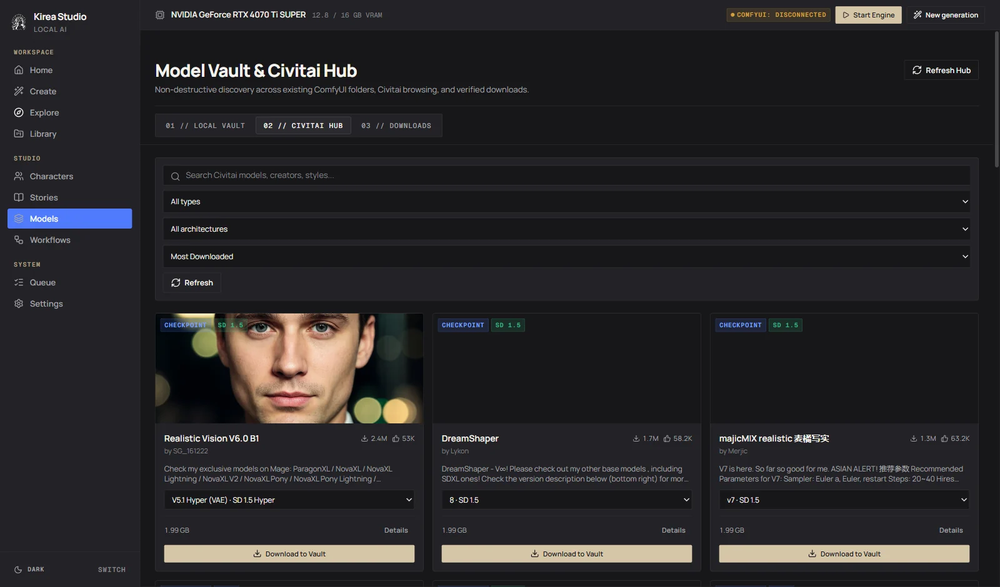
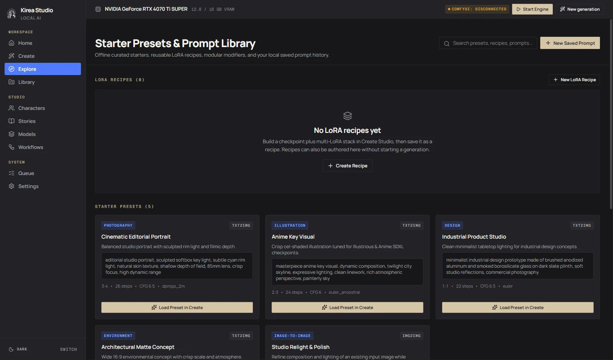
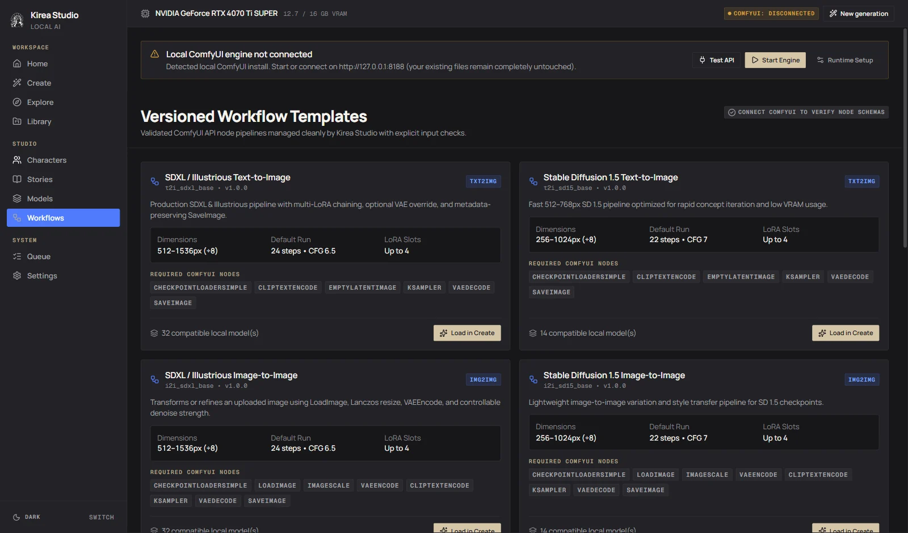
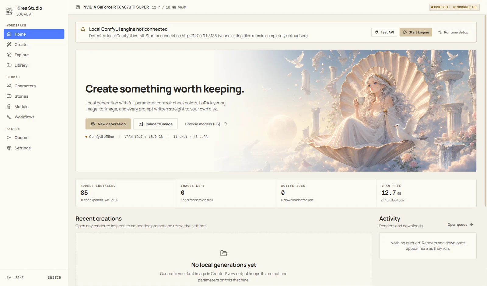
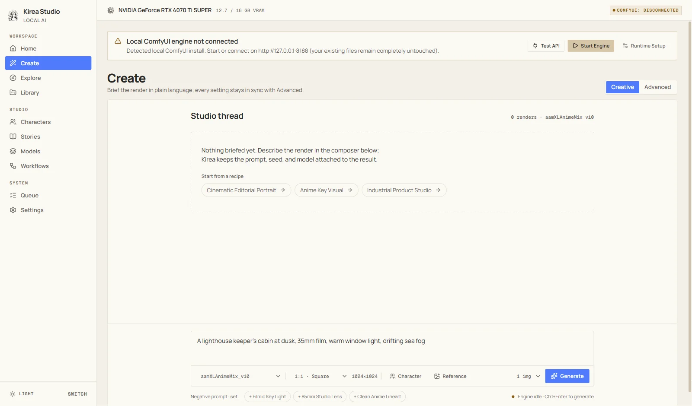
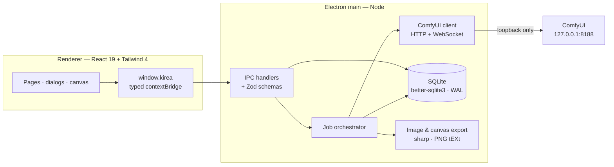

<div align="center">
  
</div>

<h1 align="center">Kirea Studio</h1>

<p align="center">
  <strong>A local-first AI image studio for Windows.</strong><br/>
  A native desktop workspace around your own ComfyUI engine — no account, no cloud queue, no node graph.
</p>

<p align="center">
  <a href="https://github.com/kaelharris/kirea-studio/releases/latest"></a>
  <a href="#quick-start"></a>
  <a href="LICENSE"></a>
  
  
  
  
</p>

---

Kirea Studio turns a local ComfyUI installation into a finished creative studio. You get a prompt composer, a searchable image library, a model vault, characters and sequenced stories — while every prompt, seed, LoRA stack, and rendered file stays on your own disk.

It is built for people who already run ComfyUI and want a workspace around it, and for people who want a managed runtime they never have to configure by hand.

## A studio, not a node graph



| Create | Models |
|:---:|:---:|
|  |  |
| **Explore** | **Workflows** |
|  |  |

| Light — Home | Light — Create |
|:---:|:---:|
|  |  |

## What it does

**Create** — Write a brief in plain language or tune every parameter in Advanced. Text-to-image, image-to-image, 4× upscaling, multi-LoRA stacking, snapped aspect ratios by model family, and live step previews over ComfyUI's WebSocket. Performance profiles scale the workflow for 8–12 GB cards and for 16 GB and above.

**Library** — Every render is indexed in SQLite with its prompt, seed, model, and parameters. Search, favourite, collect, tag, inspect, and send any image back to Create with one click. PNG metadata is preserved (`prompt`, `workflow`, and a structured `kirea_meta` chunk); JPEG and WebP export can strip it.

**Models** — A non-destructive vault that scans existing ComfyUI folders and `extra_model_paths.yaml`, flags duplicates and incomplete files, and reads tensor headers to classify architectures. A Civitai hub browses and downloads models with file size, free-space checks, SHA-256 verification, and pause/resume.

**Characters & Stories** — Identity profiles that inject prompt tokens, checkpoints, and LoRA recipes into every generation. Story Studio sequences scenes into a draft, and Story Canvas lays them out with overlays and exports to PNG or PDF.

**Pixel Studio** — A separate, local game-asset workspace: seeded pixel generation for characters, creatures, items, tilesets, and effects; persistent character identities with four facings; a real frame timeline with playback, onion skin, and frame editing; a full pixel editor with crop and nearest-neighbour resize; version history; and exports to PNG, sprite sheets, GIF/APNG, ZIP, Godot `SpriteFrames`, and Unity/Phaser atlases. Rendering is deterministic and CPU-only, so it works without ComfyUI and leaves existing models untouched. See [Pixel Studio](docs/PIXEL_STUDIO.md).

**Craft** — Dark, Light, and Match System themes on one token set; Manrope for UI and Geist Mono for technical text, using the fonts already bundled with the app. Generation progress, completion, and failure are announced to screen readers.

## Two ways to run the engine

| | Option A — Existing install | Option B — Managed runtime |
|---|---|---|
| **Detection** | Finds `ComfyUI/main.py` or a Windows portable install | Downloads the official Comfy-Org Windows Portable NVIDIA release |
| **Footprint** | Read-only; launches with isolated output, temp, input, and user paths | Isolated under `%APPDATA%\ai-image-studio-desktop\runtime\comfyui-managed` |
| **Models** | Uses the folders you already have | Lives in a separate model store and is linked in through `extra_model_paths.yaml` |
| **Ownership** | Never terminates a ComfyUI process it did not spawn | Owns and can stop the process it started |

Both modes talk only to loopback HTTP and WebSocket (`127.0.0.1:8188` by default). See [Runtime Compatibility](docs/RUNTIME_COMPATIBILITY.md) for the verified versions and exact CLI flags.

## Install

Kirea Studio ships as a per-user NSIS installer for Windows 10/11 x64. There is no bundled model weight and no bundled Python environment: the installer contains the app, and the managed runtime is downloaded only if you choose it.

**[Download Kirea Studio 1.1.1 for Windows](https://github.com/kaelharris/kirea-studio/releases/latest)** (138 MB, unsigned — verify the SHA-256 on the release page). It installs per user with Desktop and Start Menu shortcuts.

To produce the installer from source:

```powershell
npm install
npm run dist:win
```

The setup executable is written to `release/`. It installs with Desktop and Start Menu shortcuts and leaves `%APPDATA%` app data untouched on upgrade.

## Quick start

Prerequisites: Windows 10/11 x64, Node.js 22+ (Node 24 tested), and optionally a local ComfyUI install.

```powershell
git clone https://github.com/kaelharris/kirea-studio.git
cd kirea-studio
npm install
npm run rebuild:electron   # rebuild better-sqlite3 for Electron's ABI
```

For the live development loop, run Vite and Electron in two terminals:

```powershell
# terminal 1 — renderer with HMR
npm run dev

# terminal 2 — main process against the dev server
npm run build:electron
$env:VITE_DEV_SERVER_URL = "http://localhost:5173"
npx electron .
```

Or build everything and launch the production bundle:

```powershell
npm run build
npx electron .
```

Full setup, scripts, and troubleshooting live in [Development](docs/DEVELOPMENT.md).

## Architecture



The renderer never touches the filesystem, the database, or the network. It calls a typed `window.kirea` API; every call is validated in the main process, checked against the trusted window, and restricted to loopback hosts and approved roots. Full detail — including the generation state machine, schema migrations, and export pipeline — is in [Architecture](docs/ARCHITECTURE.md).

## Where your data lives

| Data | Location |
|---|---|
| Application | Your chosen install folder (per-user NSIS) |
| Database, logs, caches | `%APPDATA%\ai-image-studio-desktop` |
| Managed runtime | `%APPDATA%\ai-image-studio-desktop\runtime\comfyui-managed` |
| App-managed models | `%APPDATA%\ai-image-studio-desktop\models` |
| Generated images | `%USERPROFILE%\Pictures\Kirea Studio` (configurable) |

Nothing is uploaded. There is no account system, no analytics, and no telemetry. The only outbound requests are the ones you trigger: Civitai browsing and model downloads, and the official ComfyUI release check when you use the managed runtime. Your Civitai API key is stored with Electron `safeStorage` (DPAPI on Windows), never in the database or in plain text.

## Documentation

| Document | What's inside |
|---|---|
| [Architecture](docs/ARCHITECTURE.md) | Process model, IPC boundary, generation pipeline, persistence, security |
| [Development](docs/DEVELOPMENT.md) | Setup, scripts, dev loop, testing, packaging, troubleshooting |
| [Runtime Compatibility](docs/RUNTIME_COMPATIBILITY.md) | Verified ComfyUI versions, isolation flags, VRAM profiles |
| [Pixel Studio](docs/PIXEL_STUDIO.md) | Pixel engines, generation, timeline, editor, data model, exports, limitations |
| [UI System Design](docs/UI_SYSTEM_DESIGN.md) | Tokens, typography, theme model, component rules |
| [Test Report](docs/TEST_REPORT.md) | Coverage areas and verification notes |
| [Release Notes](RELEASE_NOTES.md) | What changed in each version |
| [Third-Party Notices](THIRD_PARTY_NOTICES.md) | Dependencies, licenses, and integration boundaries |
| [Contributing](CONTRIBUTING.md) | How to propose and submit changes |

## Status — v1.1.1

Version **1.1.1** plus the Pixel Studio workspace. Typecheck is clean and 113 tests pass; the live end-to-end generation test is opt-in via `KIREA_E2E_COMFY_PATH`. Pixel Studio was exercised in the packaged app: generation, playback, editing, versioning, character facings, exports, and persistence. The NSIS installer is built, smoke-tested, and published on the [releases page](https://github.com/kaelharris/kirea-studio/releases/latest).

## License

MIT © 2026 [kaellabsstudio](LICENSE). Kirea Studio is an independent application. ComfyUI is a separate GPL-3.0 project and is not bundled or linked; see [Third-Party Notices](THIRD_PARTY_NOTICES.md).
