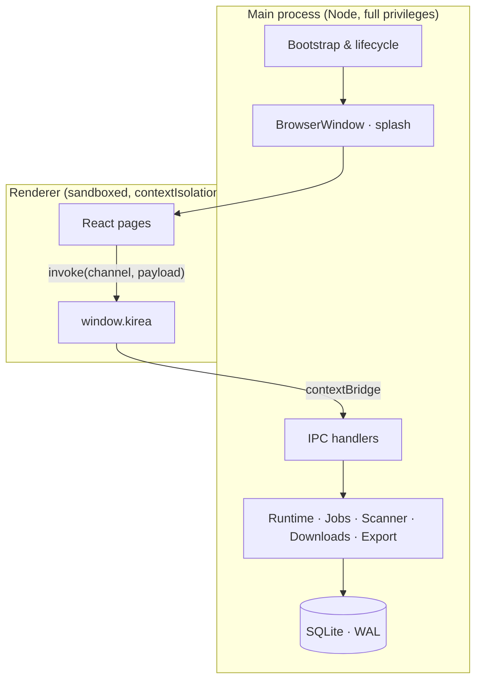
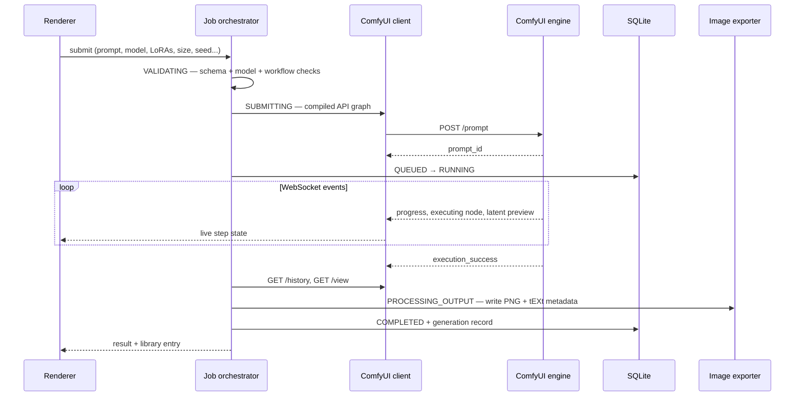

# Architecture

Kirea Studio is an Electron desktop application with a strict split between a presentation-only renderer and a privileged main process. This document describes the process model, the data path of a generation, how persistence and security are enforced, and where to make changes.

## Design constraints

- **Local only.** Inference happens in a ComfyUI process on loopback. There is no hosted backend, no account, and no telemetry.
- **Non-destructive.** Existing ComfyUI installations and model folders are read, never rewritten.
- **Boring persistence.** SQLite with versioned migrations; no schema drift between releases.
- **One typed boundary.** The renderer talks to the main process through one validated API, not through ad-hoc channels.

## Process model

- `src/main/index.ts` owns app startup, the splash window, window creation, the runtime manager, the job orchestrator, and service wiring.
- `src/main/preload.ts` exposes `window.kirea` with `contextBridge`. It is deliberately sandbox-compatible: no runtime relative `require` calls, and its channel list is kept in sync with `src/shared/ipc-channels.ts` by a test.
- The renderer (`src/renderer`) is a Vite + React 19 + Tailwind 4 application. It holds no Node access and no database handle.

### Startup sequence

1. Electron starts hidden with the theme pre-resolved from `localStorage` (`kirea.theme`) so the first paint never flashes the wrong palette.
2. The splash window loads `src/splash.html` with the bundled key art, and stays up for a minimum hold.
3. The main window loads `dist/index.html` (production) or `VITE_DEV_SERVER_URL` (development).
4. The database opens, migrations run, settings load, model scanning starts, and the splash cross-fades out over the already-rendered window.
5. On boot the job orchestrator reconciles jobs left in a non-terminal state by marking them failed, so a crash never leaves a job running forever.

## IPC boundary

All renderer-to-main calls go through channels declared in `src/shared/ipc-channels.ts`. Handlers live in `src/main/ipc/handlers`, registered by `register-handlers.ts`.

Every handler call passes through the same guards in `src/main/security.ts`:

| Guard | Rule |
|---|---|
| Trusted sender | The `IpcMainInvokeEvent` must come from the main window's `webContents` and a URL equal to the packaged `dist/index.html` or the dev-server origin. |
| Schema validation | Payloads are parsed with Zod (`src/main/ipc/schemas.ts`) before any service sees them. |
| Loopback hosts | ComfyUI hosts are limited to `127.0.0.1`, `localhost`, and `::1`; anything else is rejected. |
| Path containment | File operations are resolved and must stay inside approved roots (output folder, model roots, app data). |
| External URLs | Only `https:` links are opened externally, and never file paths. |

The renderer content security policy in `index.html` restricts scripts to `'self'`, styles to `'self'` plus inline (Tailwind runtime), images to `self`, `data:`, `blob:`, the custom `kirea-media:` protocol, and Civitai previews. Connections are limited to `self` and localhost.

## Persistence

SQLite through `better-sqlite3` in WAL mode, opened by `src/main/db/database.ts`. If the file is unreadable, the database service quarantines it and starts a clean store instead of crashing the app.

Migrations are append-only and live in `src/main/db/migrations.ts`:

| Version | Name | Adds |
|---|---|---|
| 1 | `initial_schema` | Generations, models, settings, collections, saved prompts |
| 2 | `model_metadata_and_lora_recipes` | Model metadata, favourites, LoRA recipes |
| 3 | `character_profiles` | Character identity profiles and reference links |
| 4 | `story_studio_and_canvas` | Stories, scenes, cast, canvas records |
| 5 | `canvas_overlays` | Overlay elements for canvas layouts |

Repositories in `src/main/db/repos` are the only code that writes SQL: `generations-repo`, `models-repo`, `characters-repo`, and `stories-repo`. Services receive a `StudioRepository` and never open their own connection.

All paths derive from `src/main/paths.ts`, which resolves `app.getPath("userData")` once and creates the directory tree (`logs`, `cache`, `temp`, `models`, `runtime`, `model-previews`, `characters`, `downloads`).

## The path of a generation

Job lifecycle: `IDLE → VALIDATING → SUBMITTING → QUEUED → RUNNING → PROCESSING_OUTPUT → COMPLETED`, with `FAILED` and `CANCELLED` as terminal exits. The orchestrator runs one active ComfyUI prompt at a time, keeps a pending queue, and supports cancel and retry. Failures are classified (`JobErrorKind`) so the UI can distinguish a disconnected engine from a validation error or an out-of-memory failure.

Workflows are compiled, not hand-written per render. `src/main/comfy` contains:

| Module | Responsibility |
|---|---|
| `workflow-registry.ts` | Versioned templates (`t21_sdxl_base`, `t21_sd15_base`, upscale graphs) and their node contracts |
| `workflow-templates.ts` | Base graph definitions in ComfyUI API format |
| `workflow-graph-builder.ts` | Injects prompts, models, LoRAs, VAE, dimensions, seeds, and hires/upscale stages |
| `workflow-validation.ts` | Checks required nodes, dimensions, LoRA compatibility, and model family before submit |
| `comfy-adapter.ts` | REST client: `/system_stats`, `/prompt`, `/queue`, `/history`, `/view`, `/upload/image`, `/interrupt` |
| `comfy-ws.ts` | WebSocket client for progress, node execution, and preview frames |
| `runtime-manager.ts` | Detects, launches, installs, and stops ComfyUI; owns only the process it started |

## Runtime management

**Option A — external install.** The runtime manager scans common locations for `ComfyUI/main.py` and portable builds. When launching one, it passes loopback-only and isolated-path flags (`--output-directory`, `--temp-directory`, `--input-directory`, and `--user-directory` / `--database-url` when the install's `cli_args.py` supports them). It inspects `cli_args.py` read-only first so older versions are not broken by unknown flags. It never stops a process it did not spawn.

**Option B — managed runtime.** It queries the official `Comfy-Org/ComfyUI` GitHub releases, downloads the Windows Portable NVIDIA archive with resumable range requests and disk-space checks, verifies integrity, and extracts it with bundled `7za.exe` into `userData/runtime/comfyui-managed`. Models stay in `userData/models` and are linked in via an `extra_model_paths.yaml` written only inside the managed runtime, so replacing the runtime never touches your models.

## Models and downloads

The model scanner lives in `src/main/models`: it walks the configured model roots plus `extra_model_paths.yaml`, hashes identity (name, size, path), flags duplicates and incomplete files, and reads safetensors tensor headers to classify architectures instead of trusting folder names. This drives the Create model picker, LoRA compatibility warnings, and the vault UI.

Downloads are explicit and verified. `src/main/downloads/download-manager.ts` streams with pause/resume, tracks speed and ETA, checks free disk space before starting, and verifies SHA-256 on completion. The Civitai client (`src/main/civitai`) adds catalogue search, model metadata, and an API key stored through Electron `safeStorage` (DPAPI on Windows).

## Images and exports

`src/main/images/image-exporter.ts` writes generated files and produces exports.

- PNG output receives uncompressed `tEXt` chunks injected before `IEND`: `prompt`, `workflow`, and a structured `kirea_meta` JSON chunk. This keeps ComfyUI compatibility and gives Kirea a reliable way to restore settings.
- JPEG and WebP export go through `sharp`, with optional metadata stripping for sharing.
- Story canvases are laid out in `src/shared/canvas-layout.ts` and rendered by `src/main/stories/canvas-exporter.ts` in an offscreen window: `capturePage` for PNG and `printToPDF` for PDF.

## Failure handling

- The database is quarantined and recreated if it cannot be opened.
- Startup marks interrupted jobs as failed.
- The runtime banner distinguishes "not connected" from real errors, with raw engine text behind a disclosure.
- Corrupt or missing library files surface as explicit "File missing" entries with a bulk remove action rather than silent gaps.

## Where to change what

| You want to… | Start here |
|---|---|
| Add or change a screen | `src/renderer/pages`, then the nav in `src/renderer/app/app-constants.ts` |
| Add an API call | `src/shared/ipc-channels.ts`, `src/shared/api.ts`, `src/main/ipc/schemas.ts`, a handler, and `src/main/preload.ts` |
| Change a workflow | `src/main/comfy/workflow-templates.ts` and `workflow-graph-builder.ts` |
| Add a migration | Append to `src/main/db/migrations.ts`; never edit an applied migration |
| Change design tokens | `src/renderer/index.css` (see [UI System Design](UI_SYSTEM_DESIGN.md)) |
| Change packaging | `electron-builder.yml` |

Related: [Development](DEVELOPMENT.md) · [Runtime Compatibility](RUNTIME_COMPATIBILITY.md) · [UI System Design](UI_SYSTEM_DESIGN.md)
