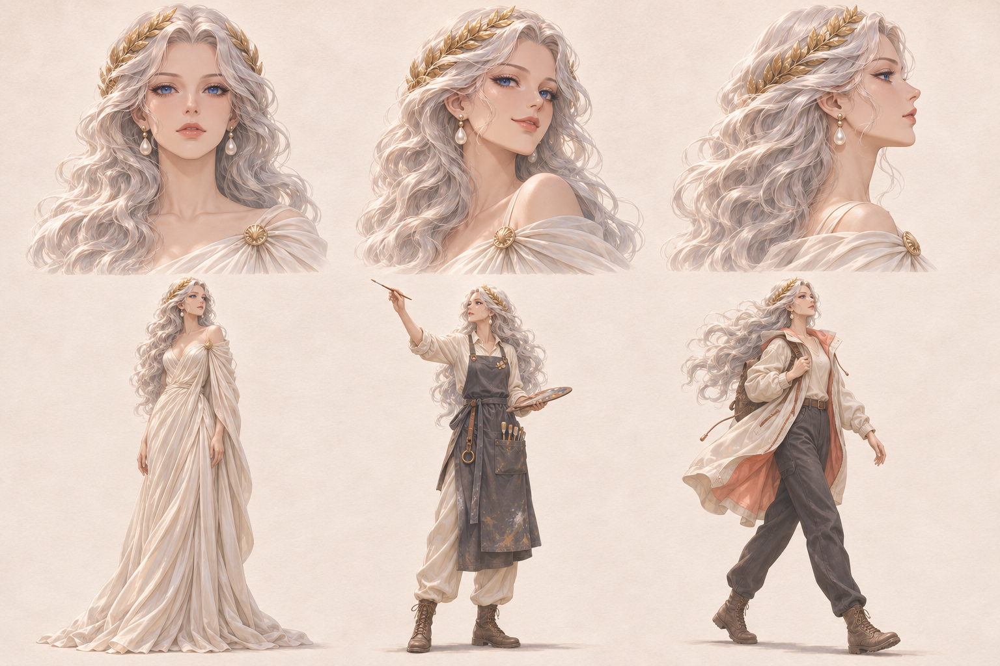

# KIREA character bible

The production sheet records the same adult muse in three head angles and three full figure poses. Its face source is the [original Heavenly Garden splash](../../assets/brand/splash-heavenly-garden.jpg), where the eyes, facial structure and accessories are clearest. The [early website hero](../../vibe_images/kirea-hero-muse_1794919821380_5c8234a4.png) supplies the full figure silhouette and original ivory drape. The sheet is the reference for new poses and wardrobe.

## Identity to keep

| Feature | Reference |
| --- | --- |
| Face | A softly tapering oval, high gentle cheekbones, a narrow straight nose and softly shaped coral lips. Warm peach ivory skin. |
| Eyes | Almond shaped cobalt eyes with defined upper lashes and fine, softly arched brows. Preserve the spacing and the shape of the lower lid. |
| Hair | Long pearl silver hair with a center part, large S waves and fine tendrils around the face. The silhouette remains legible in profile and at small sizes. |
| Accessories | A slim antique gold laurel set close to the hair, teardrop pearls, and a small fluted shell clasp. The laurel can become a three leaf pin for workwear. |
| Proportions | A graceful adult figure, roughly seven to seven and a half heads tall in the sheet. The original splash shows only the upper body. Use the early hero and the new full figure studies for stance and scale. |
| Expression | Calm, curious and attentive. Let the eyes and the working gesture communicate intent. |

## Wardrobe and staging

The ivory pleated gown and shell clasp are the signature outfit. Use the cream shirt and slate apron for hands-on work. Use the ivory jacket with coral lining and plain dark trousers for movement. Adjust fabric, lighting, pose and medium to the scene. Keep the hair shape and facial landmarks consistent across all three outfits.

Attach the original splash and this sheet to muse generation. Use the splash to resolve facial details and the sheet for alternate views and working poses. Treat the garden, shell backdrop and dove in the splash as scenery. For pixel art, reduce the clues to the silhouette of the long silver waves, a small cobalt eye cluster, a pearl highlight and a gold hair pin. Keep those clusters on one pixel grid.

The muse appears in the hero, Image Studio, Video Studio, Character & Animation and Pixel Studio. The archive, workflow, atelier and download scene carry the collection through materials, color and the shell motif.
